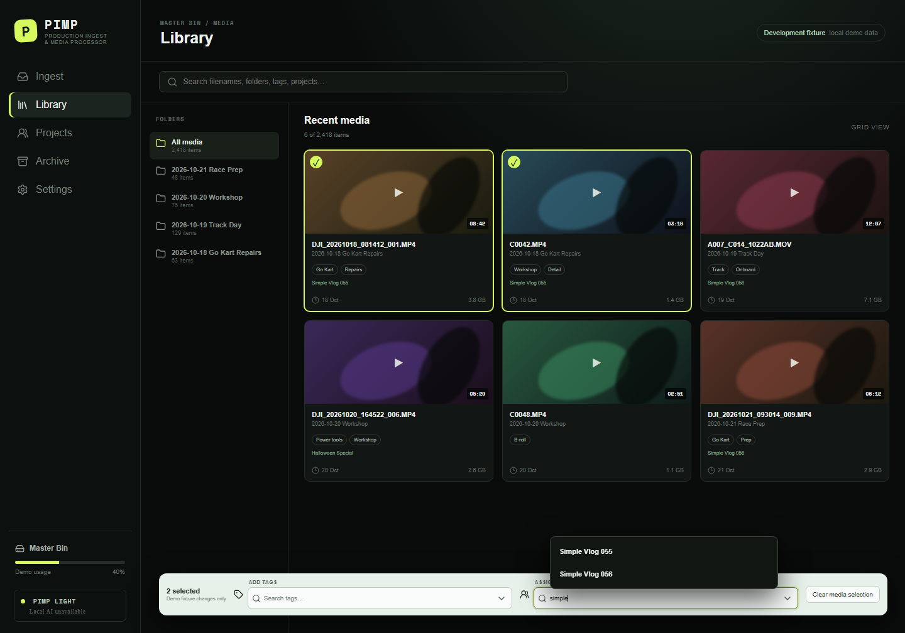

# Kairix PIMP

> **Early development:** PIMP is not yet ready for production media, and no
> installable release is available.

Kairix PIMP (Production Ingest & Media Processor) is a desktop companion for Syncthing that safely ingests, catalogues, searches, and assigns production media. Syncthing remains the synchronization engine; PIMP owns media workflow and portable metadata.

PIMP does not replace Syncthing or implement another synchronization service. A synchronized **Master Bin** holds media and authoritative portable metadata, while **Working Projects** hold active Premiere projects and their assets. Absolute paths stay device-local.

## Editions

- **PIMP Light** is the complete non-AI application: verified ingest, catalogue and search, metadata, project assignment, Premiere integration, and archiving workflows. It can read AI metadata generated elsewhere but will not ship AI models or inference runtimes.
- **PIMP Full** will use the same catalogue and application, with optional local workers for transcription, timestamped search, scene and activity descriptions, sound recognition, and suggested tags.

Full-edition AI processing is planned and is not implemented in this milestone.

## Milestone status

This repository contains the first vertical-slice foundation. The portable TypeScript core and Node filesystem adapter implement and test checksum-verified single-file ingest, collision/duplicate handling, catalogue event replay, tags, project assignments, project manifests, settings separation, safe paths, FFprobe, and thumbnail generation. The React application shell presents the primary navigation, library, batch selection, search, and the two exact date-mode choices.

The library fixture now uses one shared accessible searchable selector for batch tags and many-to-many project assignment. It supports keyboard/mouse use, stable IDs, explicit tag creation, and portal-based popovers, but changes remain in demo memory and are not persisted to the real catalogue.

The Tauri 2 shell is scaffolded but has **not** been compiled in this environment because Rust and a Windows C++ build toolchain are not installed. Folder drag/drop wiring, native path selection, real UI persistence, Premiere, AI, and archive cleanup are not claimed as complete.

Windows is the first release target. The core and adapter boundaries are designed for future Linux and macOS support, but neither platform is currently verified.

## Development

Prerequisites for the verified web/core workflow:

- Node.js 22+ and npm 10+
- FFmpeg/FFprobe on `PATH` for media probing and thumbnails

Install and run:

```powershell
npm install
npm run dev
```

Open <http://localhost:1420>. Quality checks:

```powershell
npm test
npm run lint
npm run format
npm run build
```

For the native application, additionally install the current stable Rust toolchain, Microsoft C++ Build Tools with the Desktop C++ workload, and WebView2. Then run:

```powershell
npm run tauri dev
```

## Planned work

- Native recursive camera-card ingest with resumable job records
- Virtualized browsing, saved compound filters, contact sheets, and previews
- A tested Adobe Premiere UXP extension and import reconciliation
- Optional, offline local media intelligence in PIMP Full
- Verified complete-source and consolidated project archives
- Synchronization-aware, recoverable cleanup with explicit authorization
- Windows Light and Full installers, followed by Linux and macOS validation

See the [project brief](docs/PROJECT_BRIEF.md), [development roadmap](docs/DEVELOPMENT_ROADMAP.md), and [testing strategy](docs/TESTING.md) for scope and evidence boundaries.

## Known limitations

- The desktop UI currently displays explicitly labeled synthetic fixture data.
- The tested filesystem implementation is the Node reference adapter; native Tauri command wiring remains incomplete.
- Ingest currently covers individual files rather than recursive camera-card structures.
- No Premiere integration, AI processing, project consolidation, cleanup, or installer is functional yet.
- A native Windows executable has not been built or verified.

## License

No software license has been selected yet. Public availability does not grant permission to use, modify, or redistribute the code. A license decision remains with the project owner.

## Repository map

- `apps/desktop`: React/TypeScript UI
- `packages/core`: platform-neutral catalogue, dates, search, and AI contracts
- `packages/node-adapter`: verified filesystem operations and FFmpeg integration
- `src-tauri`: minimal Tauri 2 shell and capability boundary
- `docs`: project brief, product/architecture/data rules, decision log, testing strategy, Syncthing design, research, roadmap, and future task template

## Development preview


