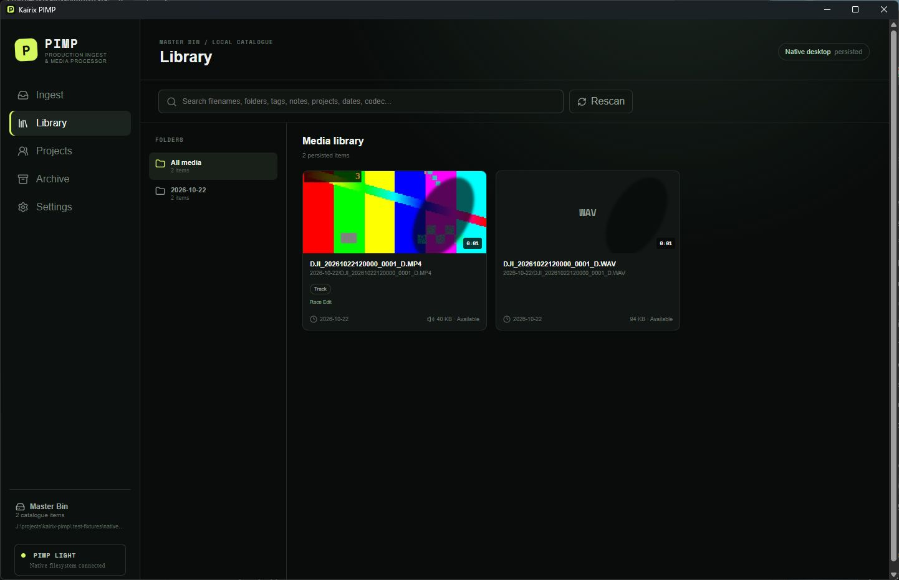

# Kairix PIMP Light

> **Windows downloads:** use the permanent [Kairix PIMP GitHub Releases page](https://github.com/Dubcodes/kairix-pimp/releases). The historical public beta is `v0.1.1-5`; source version `0.2` is a Development build and is not a public release until protected promotion completes. The recommended package is the plainly named per-user NSIS Setup executable. It is not Authenticode signed, so Windows may show a SmartScreen warning.

Kairix PIMP remains a beta and is not declared production-stable. Use disposable or independently backed-up media while installed-app, production-media and real two-device Syncthing acceptance remain incomplete. See [Windows installation](docs/WINDOWS_INSTALLATION.md), [all releases](https://github.com/Dubcodes/kairix-pimp/releases), the [official website](https://www.dubcodesmedia.com/kairix/kairix-pimp), or [report a problem](https://github.com/Dubcodes/kairix-pimp/issues).

Kairix PIMP uses explicit **Development** and **Stable** release classifications. Internal versions are valid SemVer and zero patches are hidden in the UI: `1.1.0` is shown as `1.1`. Whole-major versions such as `1.0` and `2.0` are reserved for formally approved Stable milestones; intermediate versions such as `1.1`, `1.2`, and `1.22` are Development releases. Version components are integers, so `1.22` is newer than `1.3`. Numeric shape alone never grants Stable status.

Kairix PIMP (Production Ingest & Media Processor) is a desktop companion for Syncthing that safely ingests, catalogues, searches, and assigns production media. Syncthing remains the synchronization engine; PIMP owns media workflow and portable metadata.

PIMP does not replace Syncthing or implement another synchronization service. A synchronized **Master Bin** holds media and authoritative portable metadata, while **Working Projects** hold active Premiere projects and their assets. Absolute paths stay device-local.

## Editions

- **PIMP Light** is the current non-AI Windows beta: verified ingest, catalogue and search, metadata, project assignment, project inventory, manual Premiere path handoff, and a verified external-drive project-backup foundation. It can read compatible AI metadata generated elsewhere but does not ship AI models or inference runtimes. Destructive cleanup and archive consolidation are not implemented.
- **PIMP Full** will use the same catalogue and application, with optional local workers for transcription, timestamped search, scene and activity descriptions, sound recognition, and suggested tags.

Full-edition AI processing is planned and is not implemented in this milestone. The offline, resumable evidence pipeline and timestamped schema proposal are documented in [Local AI media analysis design](docs/LOCAL_AI_ANALYSIS_DESIGN.md).

## Milestone status

The Archive workspace now creates persistent, complete project backups on a selected destination drive. Each file is staged and flushed on that drive, checked against the planned source SHA-256, atomically promoted without overwrite and independently read again before the generation becomes verified. Portable manifests preserve project-relative hierarchy; device-local jobs retain destination-volume identity and interruption evidence. Verified jobs can be rechecked or restored into a separate empty folder for a full hash comparison. This foundation does not prove Premiere dependency collection and never enables cleanup.

Degoo currently uses an explicit official-browser handoff only. Testing with a disposable Free account could not complete an independent download because the refreshed desktop web interface required Premium. No supported public unattended API was found, so PIMP does not call private endpoints, store browser sessions or claim cloud verification. See [Degoo integration evidence](docs/DEGOO_INTEGRATION.md).

Appearance settings now select the nearest real sampled first, 10%, 20%, middle, 80% or last thumbnail hold frame, or retain a bounded device-local per-media last-hover position. The source media and synchronized catalogue are not modified.

Preview preparation uses a bounded priority queue: visible and nearby shared static thumbnails run before explicit hover, automatic visible/nearby and optional idle work, while an already-running FFmpeg operation finishes safely. Appearance offers static-only, hover, visible, visible-and-nearby and idle modes. A missing static derivative entering the near viewport is generated first through its content/transform identity; hover preparation waits for that image. The resulting stable source map is shared by Library and Projects. Hover disk preparation is distinct from byte-budgeted RAM preloading, pauses during active ingest, and exposes queue, memory and disk usage in Appearance settings.

Static thumbnails and scrubbable previews now use independent processing paths, so a long hover encode cannot block visible Library images or a cached-preview read. Static FFmpeg extraction is serialized and bounded by a timeout; failed work remains retryable. Hover generation uses at most eight targeted input seeks instead of decoding through the whole recording, records the timestamps FFmpeg actually emitted and abandons the complete temporary entry after a 60-second overall limit. The blue card indicator appears only while scrub frames are loaded and usable in the frontend; a validated disk entry remains a separate stored state. Hover cache clearing does not cancel static work.

Static and hover workers now appear in the authoritative Background Operations projection. One real primary operation drives the native window title and supported Windows taskbar state without averaging unrelated jobs. The Library uses a persistent 160–360 pixel thumbnail-size control, responsive auto-fill columns, stable 16:9 cards and independently scrolling folder/media panels; changing layout size never regenerates media derivatives.

A priority-aware native gate now permits one derivative FFmpeg process globally, giving playback and visible thumbnails precedence over queued background enrichment and preview preparation after the active child exits. Playback proxies use `fastdecode`, two-second seek points and `+faststart`, with a versioned cache fingerprint and device-local startup/seek diagnostics. Clip Viewer source resolution automatically returns an existing fingerprint-matched, independently probed proxy before retrying the original, so reopening an unsupported clip does not require another manual generation request. Only completed proxies are exposed; partial streaming remains deliberately unavailable.

A device-local volume governor now coordinates full-content reads and writes across ingest inventory/copy verification, Library integrity checks, project backup/restore verification and media derivatives. Windows volume GUIDs are preferred over drive letters; source/destination permits are acquired atomically, one full-content worker is admitted per volume, independent volumes may proceed according to the Quiet/Balanced/Performance profile, automatic work can pause at safe boundaries, and repeated I/O errors produce bounded backoff. Quick Library inventory reads metadata only; SHA-256 verification remains an explicit separate operation. Resource settings and local diagnostics expose actual queue waits, volume counters, byte totals, throughput and conservative Windows input/CPU/memory idle evidence without synchronizing machine policy.

Static-thumbnail requests now retain only genuinely in-flight work. Failures and empty results leave the in-flight registry, use bounded temporary/persistent backoff, and can retry after visibility, availability, source-identity or cache-generation changes. Visible and near-visible static images have distinct priority ahead of interactive and automatic hover work. Native generation coordinates per media identity instead of waiting behind the complete enrichment pass, protects the returned cache file during eviction, and keeps FFmpeg outside the catalogue write lock.

The repository now contains a separately packaged Premiere UXP proof of concept and a native **Export Premiere manifest** handoff for selected Master Bin media, including attached WAV files. Its interchange validation is automated-test covered, but the panel has not yet been loaded or packaged with UXP Developer Tool and no real Premiere compatibility is claimed. See [Premiere Companion integration](docs/PREMIERE_INTEGRATION.md).

Static thumbnails are now validated portable derivatives beneath the shared catalogue at `.pimp/thumbnails/v1`. Their deterministic filename covers the source SHA-256, extraction time, output transform and generation version. A device reuses an arriving valid JPEG even when the original media is unavailable, incrementally migrates a valid legacy local JPEG without decoding again, and never removes shared thumbnails through ordinary local cache clearing. Hover previews and playback proxies remain bounded device-local caches. Thumbnail paths are resolved in one validated native batch per catalogue revision, and the retained source map survives scrolling, filtering and ordinary catalogue refreshes without retaining every decoded image in RAM. The packaged WebView enables Tauri's asset protocol with no static filesystem glob; the native host grants each validated JPEG exact-file access at runtime, and the CSP includes the Windows asset origin. Static image failures receive two cache-busting retries before a diagnostic placeholder, while an approximately three-row margin warms the next dozen cards.

Ingest can seed normalized tags across all eligible video, audio and image recordings while retaining later per-file edits in the existing durable job metadata. Copy remains the default and only enabled source workflow; SD-card cleanup is not implemented.

Background ingest distinguishes active work, recoverable attention states and collapsed completed history. **Clear Completed** removes only device-local history entries that the native host revalidates as fully finalized; media, catalogue events, staging journals and pending metadata are never cleared. Hover-preview requests are deduplicated with bounded in-memory retention, and disk-cache clearing waits for active generation.

The Windows vertical slice now connects the React interface to a restricted Tauri 2 host. Versioned per-device append-only event streams are authoritative; the Library is rebuilt by deterministic topological replay and no synchronized mutable database is operational state. The host accepts native file/folder pickers and drops, inventories every discovered file before copying, and queues recursive ingest as durable device-local background jobs. Common production video, audio and still formats plus camera sidecars and unknown package files are retained; deliberate temporary-file exclusions and unreadable/traversal failures are reported. Camera-package and duplicate-name folder structure is preserved with source-relative provenance, including distinct roots selected in one ingest, and planned relative destinations are reviewable before copying. Inventory traversal, checksumming and duplicate inspection run in one serialized blocking worker with cancellable item/byte progress, so removable-media reads do not block the WebView event loop. A bounded ingest worker independently verifies copied bytes against the approved inventory hash, rechecks the removable-volume identity and source, verifies staging, and promotes without overwrite while the Library remains usable. The Background Operations view reports inventory, ingest, discovery, enrichment and backup activity. A single-instance guard prevents two desktop processes from writing the same device stream.

The Library displays genuine persisted records, device-local availability, technical metadata and FFmpeg thumbnails. Applicable local video cards lazily generate low-resolution, silent hover-scrub frames on first hover; unchanged fingerprinted previews are reused from a size-limited device-local cache and never synchronized. Independent offline registrations of the same normalized Master Bin path and SHA-256 converge to one logical record during replay while retaining historic ID aliases; identical bytes at different paths remain separate, and a matching path with different bytes is reported as a conflict. Unambiguous same-folder, same-stem MP4/MOV and WAV records appear as one video card by default while retaining two immutable physical files. Pairing requires exactly one video candidate and exactly one WAV, is derived again on every catalogue replay, and leaves ambiguous matches independent. The attached WAV remains searchable, contributes tags/projects to the grouped card and logical counts, is visible in clip details, revealable independently, included in grouped metadata/project operations and exported or dragged alongside the video for Premiere handoff; a device-local preference can show attached WAV cards separately with WAV-only selection semantics. Every thumbnail has an accessible independent selection checkbox backed by the same authoritative selection as click/Ctrl/Shift/Ctrl+A. Search, batch add/remove tags and projects, batch descriptions and favourites, a persistent collapsible sidebar, device-local folder sorting/custom order, many-to-many project assignment, quick/full scan controls and conservative multi-observation reconciliation survive restarts. Configured libraries begin a background scan at startup, repeat after the stability interval when candidates are pending, and continue periodic discovery without blocking navigation. Scan progress and the last result are device-local. **Copy file paths** copies newline-separated text only; it does not import media. Windows Library cards and real folder rows suppress WebView2 HTML/image dragging, wait for the configured Windows pointer threshold, and then initiate a canonical, bounded, COPY-only native file drag. Ordinary short local paths use the maintained permissively licensed `drag` crate; UNC, mapped-share canonical forms and long paths retain PIMP's guarded Shell/OLE fallback because `drag` 2.1.1 has an unresolved Windows panic for those inputs. A video selection expands to its unambiguous attached WAV and deduplicates explicitly selected physical files. Virtual-folder hierarchy is not advertised: multi-file `CF_HDROP` cannot reconstruct it, while dragging a real physical folder preserves its hierarchy naturally. Automated payload coverage and the repository-built packaged-app thumbnail pass do not replace completed Explorer and Premiere 26.0.2 cross-process drag acceptance. The manual Premiere manifest remains the structured interchange boundary, while direct IPC remains unimplemented. Lightweight polling refreshes shared event metadata and separately notices when an already-catalogued path arrives through Syncthing, without publishing availability as shared truth. Concurrent scalar edits are retained as visible conflicts. New installs show setup guidance and an empty library instead of synthetic media.

Library reliability validates JPEG bytes rather than trusting a catalogue thumbnail reference. Missing, empty or invalid shared thumbnails remain retryable and generate through a uniquely named temporary file followed by atomic no-overwrite promotion; a concurrent valid winner is reused. Broken WebView image loads fall back to the file-type placeholder. Description editing is keyed to the exact current selection with explicit saving/saved/failed feedback and stale-response protection. Explorer reveal converts canonical paths only at the Windows Shell boundary and supplies the required parent-folder plus child PIDLs; internal verified paths remain unchanged. The Library owns only its independent folder and media scroll areas; its parent cannot acquire a phantom third scrollbar, while other pages scroll naturally only when their content overflows. Double-click opens a responsive same-window Clip Viewer with native WebView2 controls, metadata editing, associated-file reveal, previous/next navigation and explicit unavailable/unsupported-codec states. On playback failure, an explicit action creates a fingerprinted H.264/AAC device-local proxy. A chosen current frame becomes a shared static derivative; source media is never modified. Installed Explorer, WebView2/HEVC, high-DPI layout and repeated 1,000-record scrolling acceptance remain required.

Library selection actions now stay in a compact fixed toolbar while the grid scrolls. Its bottom-left, bottom-center or bottom-right position and primary tag/project/favourite actions are device-local preferences with a reset control; advanced actions remain under **More actions**. Tag choices describe all/some/none presence across the physical selection. A 50-state selection-only undo/redo history preserves anchors and stable media IDs without affecting metadata or files. Arrow focus, Shift extension, Ctrl+Space/Space toggle, Ctrl+A, Enter, K, Ctrl+F, double-Escape and an accessible `?` reference are implemented while editable fields retain native typing/undo behavior.

The Projects workspace opens registered project cards, reports local status, assigned logical recordings, file count, disk usage, the deterministic main `.prproj` candidate and last scan time. Assigned recordings remain visible; potentially large available-to-add results are collapsed by default, searched/tag-filtered only when opened and mounted in 50-item pages while reusing the canonical Library thumbnail cache. Its asynchronous read-only inventory distinguishes Premiere auto-saves, media, graphics, exports, notes and other assets while preserving relative hierarchy. A conservative saved-project indexer accepts bounded gzip-XML/XML variants, rejects document types and excessive input, and builds a bounded graph from canonical `ObjectUID`/`ObjectID` definitions and their references. Named sequence definitions are deduplicated, project-bin placement distinguishes established top-level and nested sequences, and resolvable track items distinguish imported media from saved-timeline use and placement counts. Exact existing canonical paths may associate with Master Bin IDs; filename-only guesses are forbidden. Arbitrary references remain unclassified, historical labels require prior positive path evidence, and incomplete timeline coverage is shown as unknown rather than zero. Unresolved evidence remains explicit and unverified time ranges are omitted. PIMP never writes `.prproj`/`.prin`; sanitized structural fixtures are covered, but the user's real file and broad Premiere compatibility have not yet passed development-environment acceptance.

Legacy `catalogue.json`, v1 TypeScript events, v1 Rust events and compatible project manifests have explicit compatibility paths. Migration preserves the original snapshot plus a recoverable backup and is idempotent. Project folders are authorized beneath the configured Working Projects root before creation or association, and committed catalogue changes with failed manifest projections enter a durable device-local retry queue. Retrying creation of the same folder reuses its registered or pending project identity, while manifest reconciliation replaces safely established historic media aliases with canonical IDs without rewriting event history. Ingest uses a device-owned same-filesystem staging directory outside Master Bin, durable operation journals plus a versioned local job store, source-change detection and atomic no-overwrite promotion. Tags, project assignments, notes and favourite intent may be edited while copying and are committed only after successful media registration.

New installations use `yyyymmdd` date folders. Settings provide a live preview based on the current local date/time and support `yyyy`, `MM`, `dd`, `HH`, `hh`, `mm`, `ss`, and `a`; older settings retain their existing dashed pattern until explicitly changed. Today and explicit-date batches use one batch timestamp. Original-file mode uses each independent file's modified date, while every file in a detected camera package uses the earliest available package-member modification time so its hierarchy is never split across date folders.

Settings are organized into General, Library & Storage, Ingest & Discovery, Appearance, Updates, About & Support and Diagnostics. Graphite is the default token-based theme, with Adobe-style Dark, Light, Midnight, System and High Contrast alternatives. Immediate preference writes are serialized and retryable so rapid edits cannot be lost or rolled back by an older response. Release Windows builds use the GUI subsystem and suppress consoles for FFmpeg/FFprobe, while debug builds retain console diagnostics. Normal launch, a second shortcut launch, a tray click and **Show PIMP** share one logged show/unminimize/focus path; minimized autostart hides only after tray creation. Explorer reveal uses the Windows Shell selection API after media-ID lookup and canonical Master Bin validation. Safe support links are selected from a native allowlist. The recommended Windows beta package is the per-user NSIS installer; see [Windows installation and upgrades](docs/WINDOWS_INSTALLATION.md).

Version `0.2.0` (displayed as `0.2 — Development`) replaces the legacy future-numbering convention in source. Protected promotion creates immutable permanent Development or Stable GitHub Releases with installer checksums and build identity. Development and Stable updater channels remain fail-closed until the protected signing key/password and matching repository public key are provisioned and a real installed upgrade passes. The existing `v0.1.1-5` release is not overwritten. See [Windows releases and signed updates](docs/UPDATES.md).

The current reliability branch makes updater checks/installations single-flight, invalidates stale failed-download state, and prevents installation from racing active ingest, backup, scan, verification, enrichment or preview filesystem work. Repeated unchanged full Library verification still hashes files but no longer appends redundant synchronized evidence events. These corrections are automated-test verified only; automatic updates remain non-operational until protected signing configuration and a real installed Windows upgrade pass.

The Ingest page now includes an SD Card Grabber for Windows removable volumes plus manual card-folder selection. Its initial profile recursively selects case-insensitive MP4 and WAV files, freezes the reviewed inventory in a device-local approved plan, and globally compares SHA-256 content with the catalogue. A duplicate is skipped only after PIMP freshly reads an available Master Bin copy, verifies its size/hash, and confirms it did not change during verification; catalogue-only, unavailable or corrupted matches require attention unless the user explicitly chooses a new verified copy. Changing Today, Yesterday, Choose date or Use clip date stats only the frozen approved files, reads zero source-content bytes, preserves package hierarchy and writes an immutable serialized plan revision; it does not rescan the selected roots or discover new files. Destination conflicts require a reviewed rename and a newly approved plan. New files continue through the existing staged, independently verified, atomic no-overwrite ingest. Source cleanup remains disabled. Successful registrations request bounded asynchronous enrichment into the shared static-thumbnail store; local hover and proxy caches retain their separate configured capacities. Installed physical-card removal, cancellation and shutdown acceptance remains a release blocker; automated tests do not substitute for that pass.

Configure DCM Master Bin itself as the Syncthing folder. If a broader parent directory is synchronized, explicitly exclude the sibling `.DCM Master Bin.pimp-staging-*` path so incomplete device-local staging is never replicated.

The native host, web frontend, unsigned MSI and NSIS installers build on Windows. Installer signing and upgrades, a notification-based filesystem watcher, safe catalogue-location relocation, folder notes and automated Premiere integration remain incomplete.

The public prerelease publishes a recommended NSIS Setup executable, an optional
MSI, build identity and SHA-256 checksums. Pull-request workflow artifacts remain
short-lived development builds and are not approved releases.
See the [Windows beta installation and acceptance guide](docs/BETA_TESTING.md).
FFmpeg/FFprobe are optional PATH-based tools: missing tools disable thumbnails
and technical probing but do not block verified ingest or catalogue work.

Windows is the first release target. The core and adapter boundaries are designed for future Linux and macOS support, but neither platform is currently verified.

## Licensing

No software license has been selected. Public source visibility does not grant an open-source license; the repository owner must make that decision before describing Kairix PIMP as open source.

## Development

Prerequisites for the verified web/core workflow:

- Node.js 22+ and npm 10+
- FFmpeg/FFprobe on `PATH` for media probing and thumbnails

Install and run:

```powershell
npm install
npm run dev
```

Open <http://localhost:1420>. Quality checks:

```powershell
npm test
npm run lint
npm run format
npm run build
```

For the native application, additionally install the current stable Rust toolchain, Microsoft C++ Build Tools with the Desktop C++ workload, and WebView2. Then run:

```powershell
npm run tauri dev
```

## Planned work

- Byte-range ingest resume, throughput history and a notification-based watcher
- Virtualized browsing, saved compound filters, contact sheets, and previews
- A tested Adobe Premiere UXP extension and import reconciliation
- Optional, offline local media intelligence in PIMP Full
- Verified complete-source and consolidated project archives
- Synchronization-aware, recoverable cleanup with explicit authorization
- Windows Light and Full installers, followed by Linux and macOS validation

See the [project brief](docs/PROJECT_BRIEF.md), [development roadmap](docs/DEVELOPMENT_ROADMAP.md), and [testing strategy](docs/TESTING.md) for scope and evidence boundaries.

## Known limitations

- Event replay and convergence are simulated in automated tests, but actual multi-device Syncthing conflict behavior still needs an external two-device acceptance pass.
- Automatic discovery starts at launch, follows pending candidates after the 15-second stability interval, and polls every 30 seconds. A native watcher and positive transfer-completion signal are not yet wired.
- Catalogue relocation is deliberately locked after initialization until safe migration is implemented.
- Interrupted jobs retain intent and verified completed files, but an incomplete current file restarts from byte zero when explicitly retried; jobs are not automatically resumed when removable source media may be absent.
- Metadata conflicts are reported as a count; field-level conflict resolution UI remains planned.
- Hover-preview cache entries are fingerprinted, root-contained and budget-evicted; production-scale startup/thumbnail profiling remains open.
- Manual multi-path Premiere handoff is available; automated Premiere integration, AI processing, project consolidation, and cleanup are not functional.
- Unsigned MSI and NSIS bundles build and the packaged native workflow is verified; release signing and upgrade behavior remain unverified.

## License

No software license has been selected yet. Public availability does not grant permission to use, modify, or redistribute the code. A license decision remains with the project owner.

## Repository map

- `apps/desktop`: React/TypeScript UI
- `packages/core`: platform-neutral catalogue, dates, search, and AI contracts
- `packages/node-adapter`: verified filesystem operations and FFmpeg integration
- `src-tauri`: restricted Tauri 2 filesystem/catalogue host and dialog capability
- `docs`: project brief, product/architecture/data rules, decision log, testing strategy, Syncthing design, research, roadmap, and future task template

The future cloud-backup boundary is documented in the
[provider-neutral backup manifest](docs/BACKUP_MANIFEST.md). No current feature
depends on Degoo or another cloud provider.

## Development preview


