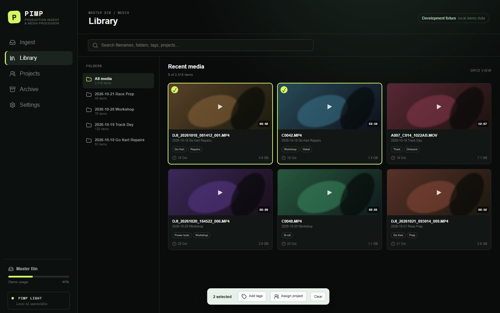

# Kairix PIMP

Kairix PIMP (Production Ingest & Media Processor) is a desktop companion for Syncthing that safely ingests, catalogues, searches, and assigns production media. Syncthing remains the synchronization engine; PIMP owns media workflow and portable metadata.

## Milestone status

This repository contains the first vertical-slice foundation. The portable TypeScript core and Node filesystem adapter implement and test checksum-verified single-file ingest, collision/duplicate handling, catalogue event replay, tags, project assignments, project manifests, settings separation, safe paths, FFprobe, and thumbnail generation. The React application shell presents the primary navigation, library, batch selection, search, and the two exact date-mode choices.

The Tauri 2 shell is scaffolded but has **not** been compiled in this environment because Rust and a Windows C++ build toolchain are not installed. Folder drag/drop wiring, native path selection, Premiere, AI, and archive cleanup are not claimed as complete.

## Development

Prerequisites for the verified web/core workflow:

- Node.js 22+ and npm 10+
- FFmpeg/FFprobe on `PATH` for media probing and thumbnails

Install and run:

```powershell
npm install
npm run dev
```

Open <http://localhost:1420>. Quality checks:

```powershell
npm test
npm run lint
npm run format
npm run build
```

For the native application, additionally install the current stable Rust toolchain, Microsoft C++ Build Tools with the Desktop C++ workload, and WebView2. Then run:

```powershell
npm run tauri dev
```

## Repository map

- `apps/desktop`: React/TypeScript UI
- `packages/core`: platform-neutral catalogue, dates, search, and AI contracts
- `packages/node-adapter`: verified filesystem operations and FFmpeg integration
- `src-tauri`: minimal Tauri 2 shell and capability boundary
- `docs`: product, architecture, data, Syncthing, research, and roadmap

No remote repository has been created and nothing has been pushed.

## Development preview


