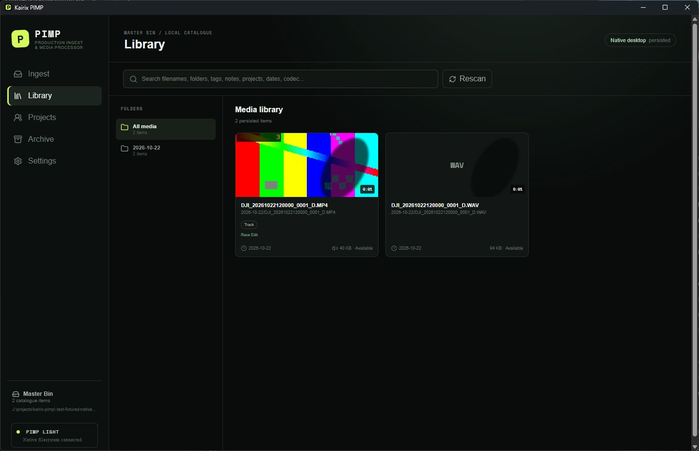

# Kairix PIMP Light

> **Public Windows beta:** [Download Kairix PIMP Light 0.1.1-5 for Windows x64](https://github.com/Dubcodes/kairix-pimp/releases/tag/v0.1.1-5). The recommended package is the plainly named per-user NSIS Setup executable. It is not Authenticode signed, so Windows may show a SmartScreen warning.

Kairix PIMP remains a beta and is not declared production-stable. Use disposable or independently backed-up media while installed-app, production-media and real two-device Syncthing acceptance remain incomplete. See [Windows installation](docs/WINDOWS_INSTALLATION.md), [all releases](https://github.com/Dubcodes/kairix-pimp/releases), the [official website](https://www.dubcodesmedia.com/kairix/kairix-pimp), or [report a problem](https://github.com/Dubcodes/kairix-pimp/issues).

Kairix PIMP (Production Ingest & Media Processor) is a desktop companion for Syncthing that safely ingests, catalogues, searches, and assigns production media. Syncthing remains the synchronization engine; PIMP owns media workflow and portable metadata.

PIMP does not replace Syncthing or implement another synchronization service. A synchronized **Master Bin** holds media and authoritative portable metadata, while **Working Projects** hold active Premiere projects and their assets. Absolute paths stay device-local.

## Editions

- **PIMP Light** is the current non-AI Windows beta: verified ingest, catalogue and search, metadata, project assignment, project inventory, and manual Premiere path handoff. It can read compatible AI metadata generated elsewhere but does not ship AI models or inference runtimes. Destructive cleanup and archive consolidation are not implemented.
- **PIMP Full** will use the same catalogue and application, with optional local workers for transcription, timestamped search, scene and activity descriptions, sound recognition, and suggested tags.

Full-edition AI processing is planned and is not implemented in this milestone.

## Milestone status

Appearance settings now select the nearest real sampled first, 10%, 20%, middle, 80% or last thumbnail hold frame, or retain a bounded device-local per-media last-hover position. The source media and synchronized catalogue are not modified.

Preview preparation now uses a bounded priority queue: an active hover runs before queued visible, nearby and optional idle work, while an already-running FFmpeg operation finishes safely. Disk preparation is distinct from byte-budgeted RAM preloading, pauses during active ingest, and exposes queue, memory and disk usage in Appearance settings.

The repository now contains a separately packaged Premiere UXP proof of concept and a native **Export Premiere manifest** handoff for selected Master Bin media, including attached WAV files. Its interchange validation is automated-test covered, but the panel has not yet been loaded or packaged with UXP Developer Tool and no real Premiere compatibility is claimed. See [Premiere Companion integration](docs/PREMIERE_INTEGRATION.md).

Thumbnail cache paths are resolved in one validated native batch per catalogue revision. Near-viewport observation and lazy decoding avoid per-card catalogue replays and Base64 image transfers during Library startup.

Ingest can seed normalized tags across all eligible video, audio and image recordings while retaining later per-file edits in the existing durable job metadata. Copy remains the default and only enabled source workflow; SD-card cleanup is not implemented.

Background ingest distinguishes active work, recoverable attention states and collapsed completed history. **Clear Completed** removes only device-local history entries that the native host revalidates as fully finalized; media, catalogue events, staging journals and pending metadata are never cleared. Hover-preview requests are deduplicated with bounded in-memory retention, and disk-cache clearing waits for active generation.

The Windows vertical slice now connects the React interface to a restricted Tauri 2 host. Versioned per-device append-only event streams are authoritative; the Library is rebuilt by deterministic topological replay and no synchronized mutable database is operational state. The host accepts native file/folder pickers and drops, inventories every discovered file before copying, and queues recursive ingest as durable device-local background jobs. Common production video, audio and still formats plus camera sidecars and unknown package files are retained; deliberate temporary-file exclusions and unreadable/traversal failures are reported. Camera-package and duplicate-name folder structure is preserved with source-relative provenance, including distinct roots selected in one ingest, and planned relative destinations are reviewable before copying. A bounded single worker independently verifies staged copies and promotes them without overwrite while the Library remains usable. The compact job view reports overall and per-file progress, inventory omissions, failures and verification state, and provides between-file pause, resume, cancellation and retry controls. A single-instance guard prevents two desktop processes from writing the same device stream.

The Library displays genuine persisted records, device-local availability, technical metadata and FFmpeg thumbnails. Applicable local video cards lazily generate low-resolution, silent hover-scrub frames on first hover; unchanged fingerprinted previews are reused from a size-limited device-local cache and never synchronized. Independent offline registrations of the same normalized Master Bin path and SHA-256 converge to one logical record during replay while retaining historic ID aliases; identical bytes at different paths remain separate, and a matching path with different bytes is reported as a conflict. Unambiguous same-folder, same-stem MP4/MOV and WAV records appear as one video card by default while retaining two immutable physical files. Pairing requires exactly one video candidate and exactly one WAV, is derived again on every catalogue replay, and leaves ambiguous matches independent. The attached WAV remains searchable, contributes tags/projects to the grouped card and logical counts, is visible in clip details, revealable independently, included in grouped metadata/project operations and copied alongside the video for manual Premiere import; a device-local preference can show attached WAV cards separately with WAV-only selection semantics. Search, desktop-style click/Ctrl/Shift/Ctrl+A selection, batch add/remove tags and projects, batch descriptions and favourites, a persistent collapsible sidebar, device-local folder sorting/custom order, many-to-many project assignment, quick/full scan controls and conservative multi-observation reconciliation survive restarts. Configured libraries begin a background scan at startup, repeat after the stability interval when candidates are pending, and continue periodic discovery without blocking navigation. Scan progress and the last result are device-local. Multi-path clipboard copy and Explorer actions provide an explicit manual Premiere handoff; no Premiere API automation is claimed. Lightweight polling refreshes shared event metadata and separately notices when an already-catalogued path arrives through Syncthing, without publishing availability as shared truth. Concurrent scalar edits are retained as visible conflicts. New installs show setup guidance and an empty library instead of synthetic media.

The Projects workspace opens registered project cards, reports local status, assigned logical recordings, file count, disk usage, the deterministic main `.prproj` candidate and last scan time. Its asynchronous read-only inventory distinguishes Premiere auto-saves, media, graphics, exports, notes and other assets while preserving relative hierarchy. Users can reveal validated project assets, edit portable project notes/tags, search and assign existing Master Bin recordings, remove assignments without deleting files, and navigate between projects and Library clips. PIMP does not parse or rewrite Premiere project internals.

Legacy `catalogue.json`, v1 TypeScript events, v1 Rust events and compatible project manifests have explicit compatibility paths. Migration preserves the original snapshot plus a recoverable backup and is idempotent. Project folders are authorized beneath the configured Working Projects root before creation or association, and committed catalogue changes with failed manifest projections enter a durable device-local retry queue. Retrying creation of the same folder reuses its registered or pending project identity, while manifest reconciliation replaces safely established historic media aliases with canonical IDs without rewriting event history. Ingest uses a device-owned same-filesystem staging directory outside Master Bin, durable operation journals plus a versioned local job store, source-change detection and atomic no-overwrite promotion. Tags, project assignments, notes and favourite intent may be edited while copying and are committed only after successful media registration.

New installations use `yyyymmdd` date folders. Settings provide a live preview based on the current local date/time and support `yyyy`, `MM`, `dd`, `HH`, `hh`, `mm`, `ss`, and `a`; older settings retain their existing dashed pattern until explicitly changed. Today and explicit-date batches use one batch timestamp. Original-file mode uses each independent file's modified date, while every file in a detected camera package uses the earliest available package-member modification time so its hierarchy is never split across date folders.

Settings are organized into General, Library & Storage, Ingest & Discovery, Appearance, Updates, About & Support and Diagnostics. Graphite is the default token-based theme, with Adobe-style Dark, Light, Midnight, System and High Contrast alternatives. Immediate preference writes are serialized and retryable so rapid edits cannot be lost or rolled back by an older response. Release Windows builds use the GUI subsystem and suppress consoles for FFmpeg/FFprobe, while debug builds retain console diagnostics. Normal launch, a second shortcut launch, a tray click and **Show PIMP** share one logged show/unminimize/focus path; minimized autostart hides only after tray creation. Explorer reveal uses the Windows Shell selection API after media-ID lookup and canonical Master Bin validation. Safe support links are selected from a native allowlist. The recommended Windows beta package is the per-user NSIS installer; see [Windows installation and upgrades](docs/WINDOWS_INSTALLATION.md).

Version `0.1.1-5` is the first public Windows beta candidate. It retains safe finalized-history clearing, bounds preview data in both the shared cache and mounted cards, and labels hover frames with FFmpeg's actual sampled timestamps. Public manual installers are permanent GitHub Release assets; automatic updates remain fail-closed until the protected signing key/password and matching repository public key are provisioned and a real installed upgrade passes. See [Windows beta distribution and signed updates](docs/UPDATES.md).

Configure DCM Master Bin itself as the Syncthing folder. If a broader parent directory is synchronized, explicitly exclude the sibling `.DCM Master Bin.pimp-staging-*` path so incomplete device-local staging is never replicated.

The native host, web frontend, unsigned MSI and NSIS installers build on Windows. Installer signing and upgrades, a notification-based filesystem watcher, safe catalogue-location relocation, folder notes, preview-frame selection and automated Premiere integration remain incomplete.

The public prerelease publishes a recommended NSIS Setup executable, an optional
MSI, build identity and SHA-256 checksums. Pull-request workflow artifacts remain
short-lived development builds and are not approved releases.
See the [Windows beta installation and acceptance guide](docs/BETA_TESTING.md).
FFmpeg/FFprobe are optional PATH-based tools: missing tools disable thumbnails
and technical probing but do not block verified ingest or catalogue work.

Windows is the first release target. The core and adapter boundaries are designed for future Linux and macOS support, but neither platform is currently verified.

## Licensing

No software license has been selected. Public source visibility does not grant an open-source license; the repository owner must make that decision before describing Kairix PIMP as open source.

## Development

Prerequisites for the verified web/core workflow:

- Node.js 22+ and npm 10+
- FFmpeg/FFprobe on `PATH` for media probing and thumbnails

Install and run:

```powershell
npm install
npm run dev
```

Open <http://localhost:1420>. Quality checks:

```powershell
npm test
npm run lint
npm run format
npm run build
```

For the native application, additionally install the current stable Rust toolchain, Microsoft C++ Build Tools with the Desktop C++ workload, and WebView2. Then run:

```powershell
npm run tauri dev
```

## Planned work

- Byte-range ingest resume, throughput history and a notification-based watcher
- Virtualized browsing, saved compound filters, contact sheets, and previews
- A tested Adobe Premiere UXP extension and import reconciliation
- Optional, offline local media intelligence in PIMP Full
- Verified complete-source and consolidated project archives
- Synchronization-aware, recoverable cleanup with explicit authorization
- Windows Light and Full installers, followed by Linux and macOS validation

See the [project brief](docs/PROJECT_BRIEF.md), [development roadmap](docs/DEVELOPMENT_ROADMAP.md), and [testing strategy](docs/TESTING.md) for scope and evidence boundaries.

## Known limitations

- Event replay and convergence are simulated in automated tests, but actual multi-device Syncthing conflict behavior still needs an external two-device acceptance pass.
- Automatic discovery starts at launch, follows pending candidates after the 15-second stability interval, and polls every 30 seconds. A native watcher and positive transfer-completion signal are not yet wired.
- Catalogue relocation is deliberately locked after initialization until safe migration is implemented.
- Interrupted jobs retain intent and verified completed files, but an incomplete current file restarts from byte zero when explicitly retried; jobs are not automatically resumed when removable source media may be absent.
- Metadata conflicts are reported as a count; field-level conflict resolution UI remains planned.
- Hover-preview cache entries are fingerprinted, root-contained and budget-evicted; production-scale startup/thumbnail profiling remains open.
- Manual multi-path Premiere handoff is available; automated Premiere integration, AI processing, project consolidation, and cleanup are not functional.
- Unsigned MSI and NSIS bundles build and the packaged native workflow is verified; release signing and upgrade behavior remain unverified.

## License

No software license has been selected yet. Public availability does not grant permission to use, modify, or redistribute the code. A license decision remains with the project owner.

## Repository map

- `apps/desktop`: React/TypeScript UI
- `packages/core`: platform-neutral catalogue, dates, search, and AI contracts
- `packages/node-adapter`: verified filesystem operations and FFmpeg integration
- `src-tauri`: restricted Tauri 2 filesystem/catalogue host and dialog capability
- `docs`: project brief, product/architecture/data rules, decision log, testing strategy, Syncthing design, research, roadmap, and future task template

The future cloud-backup boundary is documented in the
[provider-neutral backup manifest](docs/BACKUP_MANIFEST.md). No current feature
depends on Degoo or another cloud provider.

## Development preview


